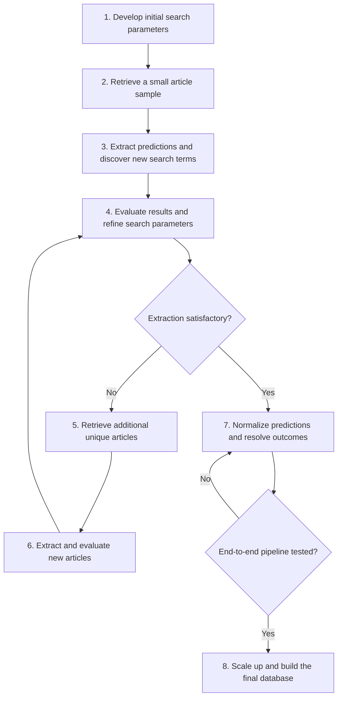

# Predictive Statements in Historical Newspapers — Project Roadmap

## Goal

Develop and validate a pipeline that extracts predictive statements from historical newspapers in Impresso, identifies their actual outcomes, and builds a database of dated predictions with verified outcomes.

The search should **not be restricted to specific topics**. Predictions are selected based on their content and quality rather than their subject area.

## Overview

## Phase 1 — Prediction discovery and extraction

### 1. Develop initial search parameters

- Review literature on future-oriented language and predictive statements to identify promising linguistic cues.
- Develop an initial set of search queries in the relevant corpus languages, exploring how individual terms, phrases and keyword combinations can be used with `AND` and `OR`.
- Give every query a unique identifier and document its rationale. Avoid topic-specific restrictions.

**Output:** An initial, documented set of search parameters.

### 2. Retrieve a small article sample

- Download a few hundred articles at most across the initial queries. Where possible, randomly sample results for each query rather than taking only the highest-ranked matches.
- Record which queries retrieved which articles, including articles retrieved by multiple queries.
- Store each unique article once in a shared article library, using its Impresso identifier. Maintain separate lists of article references for each query and retrieval round.

**Output:** A deduplicated pilot article sample with traceable search provenance.

### 3. Extract predictions and discover new search terms

- Define the criteria for a good/interesting prediction before evaluating the sample. These should be topic-independent and consider whether the predicted outcome is sufficiently clear and potentially verifiable.
- Develop a prompt for a low-cost LLM to scan each article and extract all predictions that satisfy these criteria, preserving the original wording and relevant context.
- In the same pass, ask the LLM to identify the linguistic cues associated with each candidate and suggest generalized search terms or keyword combinations for future retrieval.
- Manually review a small subset of the results, including articles for which the LLM found no predictions, to check extraction quality. Refine and then keep the prompt and model fixed for comparable retrieval rounds.

**Output:** Extracted prediction candidates, new search-term suggestions and a tested extraction prompt.

### 4. Evaluate and refine the search parameters

- For each query, calculate the proportion of evaluated articles containing at least one usable prediction (article-level precision). Also record the number of usable predictions found.
- Examine overlap between queries and the additional unique predictions or prediction-containing articles each query contributes.
- Keep promising queries, refine or deprioritize unproductive queries, and introduce new terms or combinations discovered in Step 3. Do not optimize for precision alone: lower-precision queries may uncover predictions missed by other queries.
- To estimate recall independently of the keyword selection, reserve a separate randomly sampled set of articles from the same corpus and manually identify eligible predictions in it. Check what proportion of prediction-containing articles match at least one query. If the sample contains too few positives, report recall as uncertain rather than treating retrieval yield as recall.

**Output:** An updated set of queries and a record of their performance and limitations.

### 5. Retrieve additional articles

- Run the downloader with the updated search parameters.
- Reuse articles already stored in the shared library instead of downloading them again. Record new query-to-article associations even when an article is already available.
- Add only previously unseen articles to the library and keep track of the current retrieval round.

**Output:** An expanded article library and a clearly defined set of new articles.

### 6. Evaluate the new sample and iterate

- Apply the same extraction prompt and model to newly added articles. Reuse existing extraction results if the prompt and model are unchanged.
- Compare the new sample with earlier rounds using the same eligibility criteria and metrics. Where practical, keep sampling conditions comparable and distinguish overall query precision from the yield of newly retrieved articles.
- Repeat Steps 4–6 until the results are sufficiently useful and reliable, and further refinement produces diminishing returns. Agree on practical stopping criteria before deciding to scale.

**Output:** A validated set of search parameters and a repeatable prediction extraction process.

## Phase 2 — Prediction normalization and outcome resolution

### 7. Normalize predictions and resolve outcomes

**This phase still needs methodological refinement and should also be developed iteratively on a small sample.**

- Develop a separate LLM prompt that converts each prediction candidate into a self-contained English statement. Split compound predictions into independently verifiable statements where appropriate.
- Preserve the original meaning, uncertainty and attribution. Record the publication date and the expected date or time range by which the outcome should be known, if it can be inferred reliably. Do not invent a deadline.
- Generate search terms for retrieving later Impresso articles that may document the actual outcome. Use other reliable historical sources when necessary.
- Keep normalization separate from outcome evidence to avoid reinterpreting predictions with hindsight.
- Verify the outcome against the retrieved evidence and retain references to the supporting sources. Classify each eligible prediction as true, false or unresolved; do not treat a lack of evidence as a false prediction.
- Manually check a subset of the normalized predictions and their resolutions, refine the process and repeat until it is sufficiently reliable.

**Output:** A tested process for producing self-contained predictions with evidence-backed outcomes.

## Phase 3 — Large-scale data collection

### 8. Scale up and build the final prediction database

Scale up only after the complete pipeline has been tested end to end on a small sample, from article retrieval to outcome verification.

- Retrieve and process substantially more articles using the validated search and extraction methods.
- Resolve as many predictions as possible and consolidate duplicate prediction records without losing source references or merging independent forecasts of the same event.
- Build the final database of predictions with verified outcomes. Retain unresolved predictions separately for transparency and potential follow-up.
- Document the methodology, retrieval limitations and unresolved cases so that later analysis does not mistake the resulting database for a representative sample of all historical predictions.

**Output:** The final prediction database and a reproducible, documented methodology.
